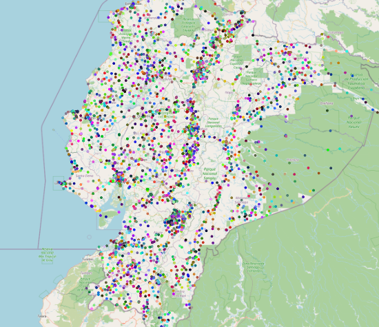
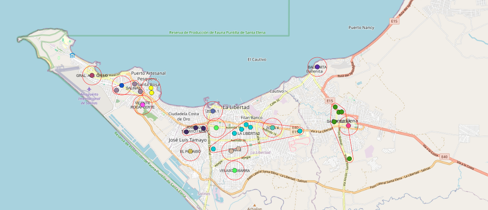
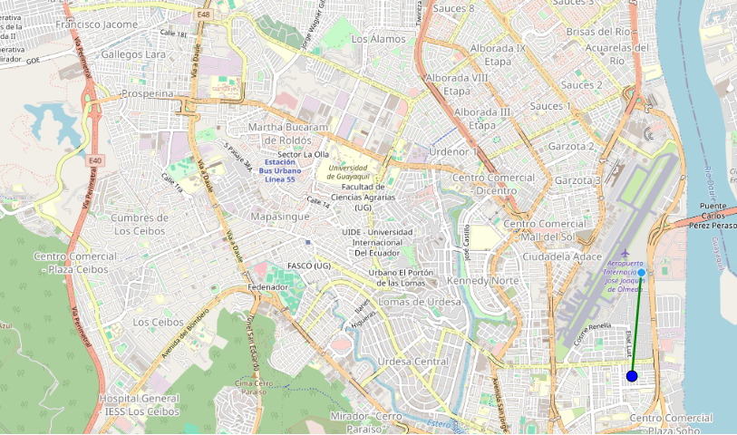

# Ecuador's Voting Centers Visualizer, Locator, Optimizer & All-Around Useful Tool 

This project is a visualizer for the voting centers in Ecuador's elections from 2017 to the present, 
intended to aid unfortunate people that are assigned to centers that are far away from their place
of residence. It displays all voting centers of the country, computes statistics based on the user's
current location, and can suggest a change of electoral domicile that could result in being assigned
to a nearer center (and consequently shorter travel times) in future elections.

It can also display the data of past elections (starting 2017), so changes in electoral zones can be viewed and tracked.

## Optimization

The main purpose of this visualizer is (in addition to showing pretty maps) to understand why a particular person 
may be getting assigned to a voting center that is very far away from their home (which thus results in long trips
every election), and to hopefully find a way to get assigned somewhere nearer.

Voting centers are classified in a three- or four-level hierarchy: Provincia > Cantón > Parroquia > Zona (this one may 
be empty, in cases where a Parroquia only has a single Zona). Every voter in the country is also assigned to a 
Provincia > Cantón > Parroquia > Zona, and everyone is only ever assigned to centers that match their zone. This means 
that if someone is assigned to a geographically large zone (i.e. a zone that has centers that are very spread out, e.g. 
over a large portion of a large city), that person will be sent to vote _somewhere_ in that large area:

If, on the other hand, a person is assigned to a zone that only contains a couple of centers that are near each other, 
then that person will only be assigned to one of those centers, and therefore to a small area:

Assignment to a particular voting center (out of all those that share the same Provincia > Cantón > Parroquia > Zona 
with the voter) is done alphabetically based on the voters' last (family) names, but the order of centers seems 
to be somewhat random, and it also varies across elections, so the geographical distribution of family names isn't predictable.

People who are currently assigned to a large zone (i.e. one with many centers and which covers a wide geographical area) 
may benefit from changing their electoral domicile to a smaller zone that is closer to their home, if one exists. This would reduce
the set of voting centers they may be assigned to, hopefully reducing both the average distance and the variability of distances.

This app suggests the five zones that have the lowest average distance to the user's current location. The average distance
to a zone is the average of all straight-line distances to that zone's centers, weighted by the number of voters handled 
by each center. For example, if a zone has two centers, one that handles 2 voters and is 2km away from the user, and 
another that handles 3 voters and is 1km away from the user, then that zone's "average distance" metric is (2\*2km + 3\*1km)/5 = 1.4km.
This method gives more importance to centers that are larger and therefore receive more voters, since the probability of
a person being assigned to those centers is accordingly larger. The five zones (out of all the country's zones) that have 
the smallest "average distance" metric are recommended to the user.

## Sources of data

The data for this visualizer comes from [CNE's past elections archive](https://www.cne.gob.ec/elecciones-anteriores/), 
particularly the document that is usually called something like "Distributivo de recintos electorales" 
(e.g. see [the page for the 2017 elections, the oldest ones recorded](https://www.cne.gob.ec/elecciones-generales-2017/)).
This document usually contains a list of voting centers, each with their Provincia+Cantón+Parroquia+Zona, the center's name 
and an address, sometimes the number of male and female voters assigned to it, the number of male&female stations that it 
has, and sometimes coordinates (in WGS-84 and sometimes EPSG:32717 coordinate systems).

Changes made to the raw data include:

* Some elections (namely the 2017, 2019, and 2023 out-of-order presidential elections) don't provide the centers'
  coordinates. For the 2017 and 2023 elections, this was fixed by using a numeric ID that each center has (which is mostly
  though not completely stable) to look up those centers on other elections that _did_ provide coordinates. Centers that 
  didn't have a match in the geolocated elections were manually added (there may be errors, some of them are in small 
  villages that neither Google nor OpenStreetMap have visited). The 2019 election doesn't even have an ID for each center 
  and I wasn't about to attempt to pair centers by name, so it will forever be left alone.
* Some coordinates are straight-up wrong, e.g. center ID 1972 in the 2024 elections is located (if attending to the 
  EPSG:32717 coordinates in columns `X` and `Y`) at 0°10'13.8"S 79°46'11.3"W, but if attending to the WGS-84 coordinates
  (columns `LONG` and `LAT`), it's located at 1°26'41.8"S 79°27'38.1"W which is about 140km away. Neither of those are
  correct either, the correct location for that center is 1°26'41.2"S 79°27'43.9"W, approx. 140km away from the EPSG:32717 
  coordinates and 180m away from the WGS-84 coordinates. All cases of this that I've been able to find are manually 
  corrected (see [the `corrections.json` file](./src/data/corrections.json))
* Some of the start/end station numbers are wrong for centers that don't have any male/female stations, e.g. center ID 5986 
  in the 2027 elections has 0 stations for men (`JUN MAS`), but it says that it handles men's stations 1 to 0 (???, see
  `JUN INIF` and `JUN FINF` respectively). These cases have their start station number set to 0 manually.

The data on last/family name frequencies (which is used to approximate to which center, out of those in a zone, a person
with a given family name may be assigned to in a particular election) comes from [INEC's Visualizador de nombres y apellidos](https://app.powerbi.com/view?r=eyJrIjoiNDliNmRkNzUtNThlZi00NDAyLWI1NGEtZGIwYmY0MDNjZTczIiwidCI6ImYxNThhMmU4LWNhZWMtNDQwNi1iMGFiLWY1ZTI1OWJkYTExMiJ9),
suitably _encouraged_ to produce not just the top 5 last names per province, but the top 5 million last names (which in 
practice mean all the last names), each with the count of people that have it. This is used to compute which 3-letters are most common
(at the start of family names) for each province, e.g. in Guayas the most common last name is Vera (61k people), but the 
most common first-3-letters is MOR (128k people, made up of Morán 41k + Mora 31k + Moreira 18k + Morales 18k + Moreno 
14k + Morocho 4k). Since there are 4060k records for Guayas, this means that ~3.1% of all people in Guayas have last names
that start with MOR. This data is then used, in reverse, to find the approximate position that a person with a given family 
name would have if all people in the province (or a random sample thereof) were to be put in a line ordered alphabetically 
by their last names, which is the same order that (apparently) is followed to assign people to voting centers in their zone
(e.g. a person with last name Abad would be among the first people and therefore assigned very near station 1F or 1M, whereas 
a person with last name Zúñiga would be ordered last and assigned to one of the last voting stations in the zone, the ones 
with the highest possible number).
